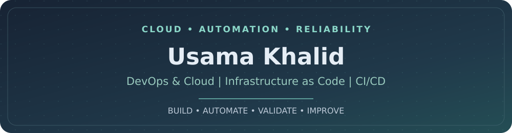

**Building reliable infrastructure through automation, containerization, and practical engineering.**

## 🌿 About Me

- 🔧 Hands-on experience with **Linux, AWS, Docker, Kubernetes, Terraform, Ansible, Jenkins, and CI/CD** through DevOps projects and training.
- 🚀 Worked with **containerized deployments, Git branch workflows, Helm charts, and infrastructure automation**.
- 🔍 Focused on **deployment reliability, troubleshooting, observability, security, and cloud cost awareness**.
- 🎯 Open to **DevOps Internship** and **Junior DevOps Engineer** opportunities.

## ⚙️ Technical Toolkit

| Area | Technologies |
|:--|:--|
| **Cloud & Infrastructure** |     |
| **Containers & Orchestration** |     |
| **CI/CD & Automation** |     |
| **Web & Observability** |     |

## 🧩 Featured DevOps Work

| Project | Implementation |
|:--|:--|
| **[E-Commerce Application](https://github.com/usamakhalid212/E-Commerce-Project)** | Multi-service Docker Compose deployment, Git branch promotion, networking, health checks, and persistent storage for MongoDB and uploads. |
| **[Dockerized Portfolio](https://github.com/usamakhalid212/Project-03-Docker)** | Containerized an Nginx-served portfolio using Docker and Docker Compose. |
| **[Nginx Deployment Automation](https://github.com/usamakhalid212/Project-02-Nginx)** | Nginx server blocks, custom logs, scripted deployments, backups, and rollback workflows. |
| **Kubernetes & Helm** | Kubernetes application deployment resources and Helm chart configuration. |
| **AWS Infrastructure as Code** | Terraform provisioning practice and an encrypted, versioned S3 remote backend with native state locking. |
| **Jenkins CI/CD** | Declarative CI/CD pipeline integrating source control, Docker builds, deployment, and verification. |

**[Explore more repositories →](https://github.com/usamakhalid212?tab=repositories)**

## 📈 GitHub Activity

---

**Build · Automate · Validate · Improve**

[LinkedIn](https://www.linkedin.com/in/usama-khalid-0034532b2/) · [Repositories](https://github.com/usamakhalid212?tab=repositories) · [Email](mailto:usamakhalid9922@gmail.com)

